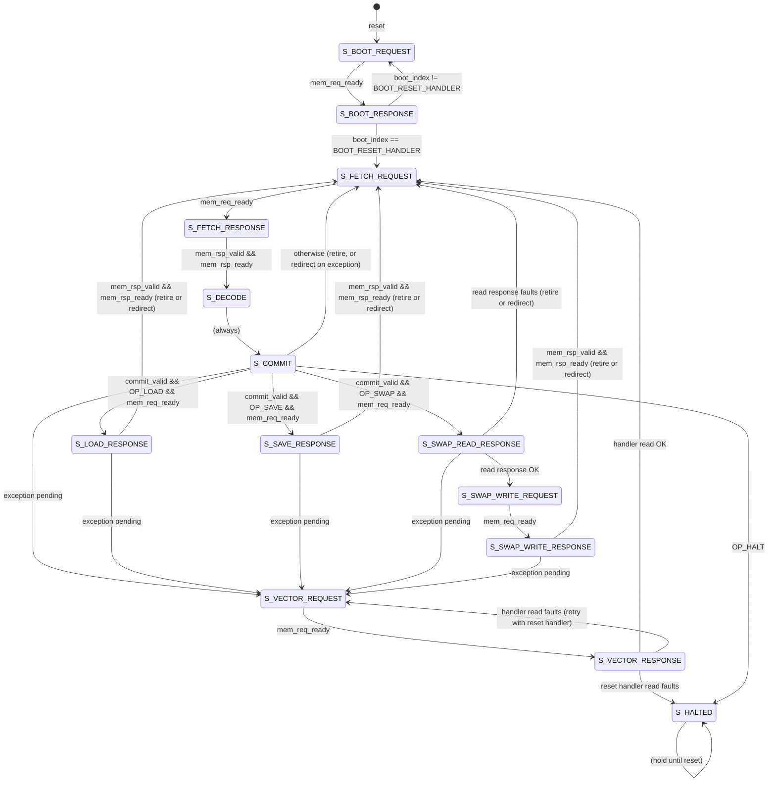

# Processor FSM

Mermaid view of the serialized processor FSM in `rtl/processor.sv`. Update this diagram whenever the FSM changes.

Notes:

- Reset boots from the vector table through `S_BOOT_REQUEST`/`S_BOOT_RESPONSE`.
- `S_COMMIT` issues bus requests for `load`, `save`, and `swap`; other instructions retire in the same edge.
- `swap` performs read then write; `Sa` commits only on a successful write response.
- `S_VECTOR_*` services exception handler fetches.
- `halted` holds in `S_HALTED` until reset.